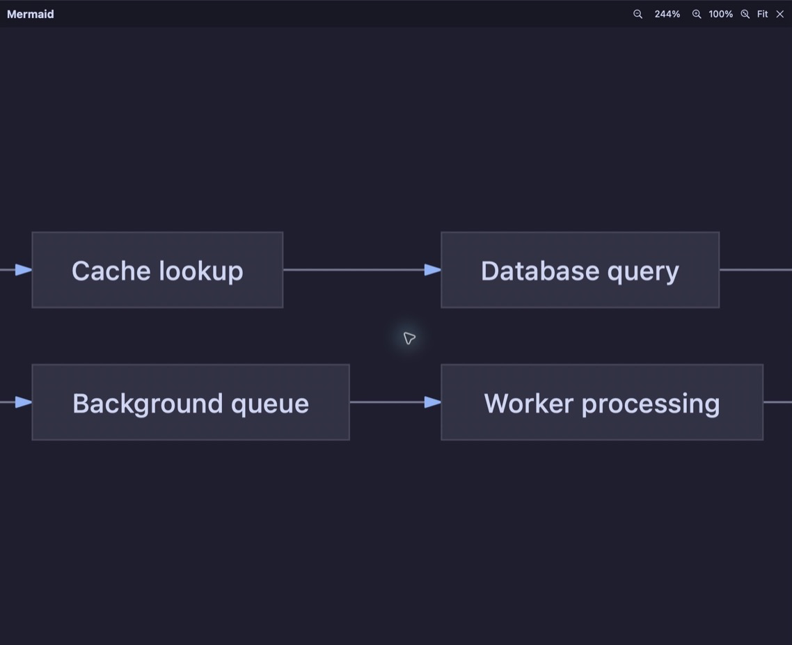

# Mermaid diagram zoom

## Problem and proposal

Wide Mermaid diagrams shrink to the Markdown column and become difficult to read. Each rendered
diagram gets an expand button at its bottom-right corner. It opens a viewer over the Markdown
preview panel; in Split mode the source editor remains available alongside it.

The viewer initially fits the whole diagram with a margin. Its toolbar offers zoom out, the
current percentage, zoom in, actual size (100%), fit and close. Dragging or scrolling pans the
diagram; trackpad pinch zooms around the pointer. Keyboard controls are `+`, `-`, `0`, `F`, arrow
keys and Escape. Zoom is limited to 800%; its lower limit always permits fitting even unusually
wide or tall diagrams. Small diagrams start at actual size.

Closing preserves the document's scroll position. Resizing refits while fit mode is active;
manual zoom retains its scale and logical center, subject to pan limits. Editing the document,
changing documents or changing preview style/theme closes the viewer so it cannot show stale content.

## Implementation and adversarial review

The document stays mounted beneath an opaque overlay owned by `MarkdownPreviewView`, outside
the lazy block hierarchy. Covered content stops receiving pointer and accessibility interaction.
Source-reveal callbacks retain their structure and check whether the viewer is open: their existing
AppKit double-click monitors can otherwise react to clicks over obscured blocks.

Parsing, layout and PDF generation happen off the main thread once per diagram source/theme.
The inline preview and viewer share that vector image. Canceled tasks cannot publish a previous
image or error. Invalid diagrams retain the source/error fallback and have no expand button.

Astra's adversarial review exposed a memory hazard in drawing a PDF-backed `NSImage` at its zoomed
size: AppKit rasterizes the destination even when the visible view is small. The viewer therefore
draws `CGPDFPage` directly into its clipped viewport. Zoom and pan neither rerun layout nor allocate
a diagram-sized backing image. No new dependencies or changes to the vendored renderer are needed.

## Verification

Automated checks cover extreme aspect ratios, fitting, actual size, anchored zoom, pan/zoom limits,
resize behavior, vector output, invalid source, cancellation and canvas focus/Escape restoration.
Existing Markdown interaction, find and scroll-memory checks cover regressions.

Manual verification uses the isolated `wooloo-ui-test-mermaid` Herdr session and a separately
identified app. It covers Theme and Document styles, Preview and Split, crisp enlarged text,
drag/scroll, fit, Escape, edits while expanded, invalid diagrams, rapid double-click opening,
double-clicks over covered blocks, and preserving document scroll after panning a tall diagram.
SSH-specific loading is unchanged; the viewer operates on the already loaded Markdown content.

